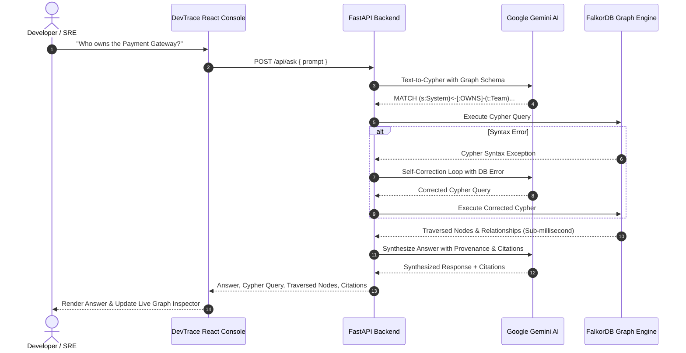
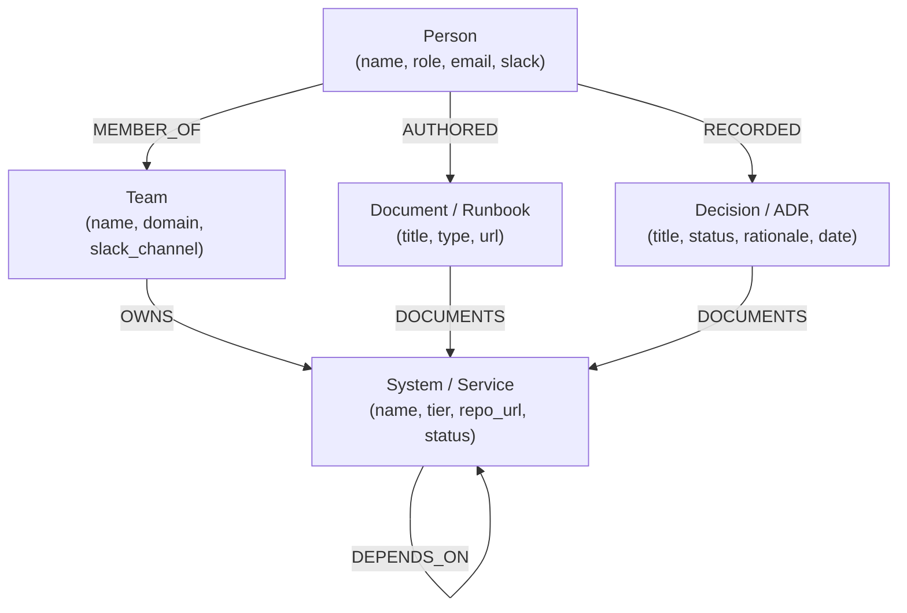

# 🧠 DevTrace: Enterprise Company Brain

[](https://wemakedevs.org)
[](https://falkordb.com)
[](https://deepmind.google/technologies/gemini)
[](https://fastapi.tiangolo.com)
[](https://vitejs.dev)
[](LICENSE)

> **DevTrace** is an enterprise-grade Knowledge Graph Intelligence Platform submitted to **Graph Hacks** by **WeMakeDevs** (Powered by **FalkorDB**).
> It turns dispersed organizational knowledge—teams, code repositories, microservices, architecture decision records (ADRs), runbooks, and incidents—into an ultra-fast queryable graph powered by FalkorDB and Google Gemini Text-to-Cypher reasoning.

---

## 📌 Submission Overview
- **Event:** WeMakeDevs Graph Hacks Hackathon 2026
- **Track:** Track 03 — Company Brain
- **Core Database:** **FalkorDB** (Low-Latency Graph Database)
- **AI / LLM:** Google Gemini Flash 2.5 (`google-genai` SDK) with Self-Correcting Cypher Loop
- **Repository:** `HelixAthu/Company-Brain`

---

## ⚡ The Problem: Organizational Blindness

Modern engineering organizations suffer from severe knowledge fragmentation:
1. **Tribal Knowledge & Silos:** Who actually owns the Payment Gateway? Who is on-call tonight?
2. **Blast Radius Blindness:** If the Billing DB fails, which customer-facing microservices crash?
3. **Lost Architectural Decisions:** Why was the legacy cache migrated? Who signed off on the change and where is the ADR?

Traditional search and vector RAG fail here because **relational topology and multi-hop dependency chains cannot be computed with simple vector similarity**.

---

## 💡 The Solution: DevTrace

DevTrace indexes the entire enterprise topology inside **FalkorDB**. When an engineer asks a question:
1. **Google Gemini Flash** converts natural language into strict, read-only Cypher queries.
2. **Self-Correction Engine** detects any schema or syntax errors and retries automatically.
3. **FalkorDB Engine** executes the query in **sub-millisecond latency** using sparse matrix linear algebra.
4. **Synthesis Engine** compiles a human-readable answer citing author engineers, teams, runbooks, and ADRs.
5. **Live Cypher Transparency Drawer** shows the exact executed Cypher query and traversed entities in real time.

---

## 🏗️ Architecture & Pipeline Flow



---

## 🧩 FalkorDB Knowledge Graph Schema

DevTrace models enterprise entities into a rich semantic graph:



### Core Entity Types:
- **`Person`**: Software engineers, architects, and SRE on-call leads.
- **`Team`**: Functional squads (Payments Team, Core Infra, Identity Team).
- **`System`**: Microservices and databases (Payment Gateway, Billing DB, Auth Microservice, FalkorDB Graph Engine).
- **`Document`**: Incident runbooks, disaster recovery procedures, architecture specs.
- **`Decision`**: Architectural Decision Records (ADRs) with rationale and date provenance.

---

## 🚀 Quickstart Guide

### 1. Prerequisites
- **Docker** (to run FalkorDB)
- **Python 3.10+** (Python 3.11 recommended)
- **Node.js 18+**

### 2. One-Command Docker Compose (Recommended)
```bash
docker compose up -d
```
This automatically launches:
- FalkorDB on port `6379`
- DevTrace FastAPI Backend on port `8000`

### 3. Manual Local Setup

#### Step A: Launch FalkorDB
```bash
docker run -p 6379:6379 -it --rm falkordb/falkordb:latest
```

#### Step B: Backend Setup
```bash
cd backend
python -m venv venv

# Activate venv:
# Windows:
venv\Scripts\activate
# Linux/macOS:
source venv/bin/activate

pip install -r requirements.txt
cp .env.example .env

# Seed the knowledge graph
python seed.py

# Launch FastAPI server
uvicorn backend.main:app --reload --host 0.0.0.0 --port 8000
```

#### Step C: Frontend Setup
```bash
cd frontend
npm install
npm run dev
```
Open [http://localhost:5173](http://localhost:5173) in your browser.

---

## 🧪 Automated Testing Suite

DevTrace includes comprehensive automated tests for endpoints and graph traversals:
```bash
pytest backend/tests/test_api.py -v
```

---

## 🌟 Key Features

| Feature | Description |
|---|---|
| **Sub-Millisecond Graph Traversal** | Powered by FalkorDB's linear algebra engine running RedisGraph protocol. |
| **Self-Correcting Text-to-Cypher** | Translates natural language into Cypher and corrects syntax errors on the fly. |
| **Live Cypher Transparency Drawer** | Inspect executed queries, syntax coloring, and traversed node graphs in real time. |
| **Blast Radius Dependency Tracing** | Determine immediate and transitive downstream service outages. |
| **Architectural Provenance (ADRs)** | Trace *why* technical decisions were made with author and runbook attribution. |
| **Bulletproof Offline Demo Mode** | Zero-failure presentation mode with instant high-fidelity answers. |

---

## 📄 License
This project is licensed under the MIT License. Submitted for **Graph Hacks Track 03 (Company Brain)**.
