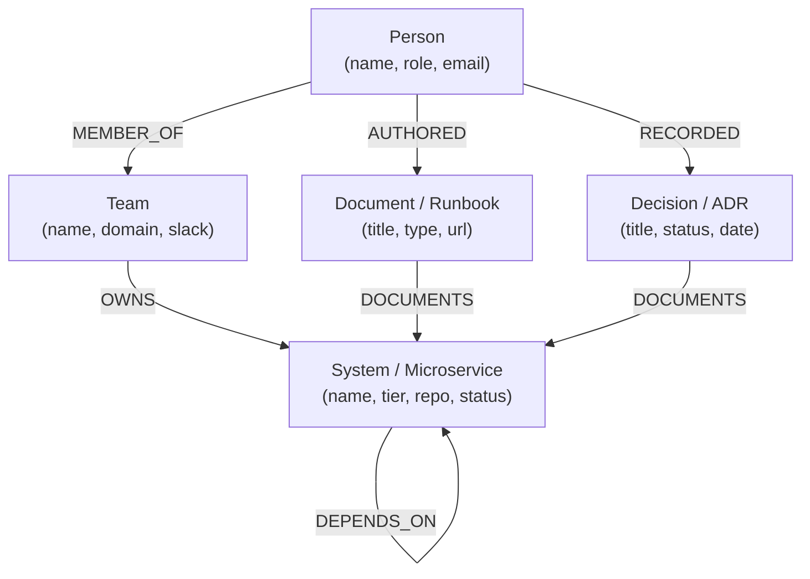

# FalkorDB Knowledge Graph Schema: Company Brain

This document defines the schema specification for the **DevTrace** Company Brain graph model stored in **FalkorDB**.

---

## 🧩 Graph Model Overview



---

## 🏷️ Node Labels & Properties

### 1. `Person`
Represents software engineers, tech leads, engineering managers, and site reliability engineers.
- `id` (String): Unique identifier (e.g., `alice_johnson`)
- `name` (String): Full name (e.g., `"Alice Johnson"`)
- `role` (String): Title or functional role (e.g., `"Staff Infrastructure Engineer"`)
- `email` (String): Corporate email
- `slack` (String): Slack handle (e.g., `"@alice"`)

### 2. `Team`
Engineering and operations squads with domain ownership.
- `id` (String): Unique squad slug (e.g., `"payments_team"`)
- `name` (String): Formal squad name (e.g., `"Payments & Checkout Squad"`)
- `domain` (String): Domain scope (e.g., `"Core FinTech & Transactions"`)
- `slack_channel` (String): Team channel (e.g., `"#team-payments"`)

### 3. `System`
Microservices, databases, event buses, and external integrations.
- `id` (String): Unique service identifier (e.g., `"payment_gateway"`)
- `name` (String): Display name (e.g., `"Payment Gateway API"`)
- `tier` (String): Criticality level (`"Tier-1"`, `"Tier-2"`, `"Tier-3"`)
- `repo_url` (String): Git repository location
- `status` (String): Operational status (`"production"`, `"deprecated"`, `"beta"`)
- `description` (String): High-level functional purpose

### 4. `Document`
Runbooks, architecture specifications, postmortems, and on-call guides.
- `id` (String): Document ID (e.g., `"doc_payment_runbook"`)
- `title` (String): Title of document
- `type` (String): `"Runbook"`, `"Architecture Spec"`, `"Postmortem"`, `"API Guide"`
- `url` (String): Link or internal wiki path
- `last_updated` (String): ISO date string

### 5. `Decision` (Architecture Decision Record - ADR)
Historical technical decisions documenting architectural rationale.
- `id` (String): ADR Identifier (e.g., `"adr_004_falkordb_migration"`)
- `title` (String): Title of the decision
- `status` (String): `"Accepted"`, `"Superseded"`, `"Proposed"`
- `rationale` (String): Summary of why the choice was made
- `date` (String): Date of decision approval

---

## 🔗 Relationships & Edges

| Edge Type | Source Node | Target Node | Semantics |
|---|---|---|---|
| `MEMBER_OF` | `Person` | `Team` | Person belongs to an engineering squad |
| `OWNS` | `Team` | `System` | Squad has primary ownership and on-call for system |
| `DEPENDS_ON` | `System` | `System` | Direct runtime or data dependency between services |
| `AUTHORED` | `Person` | `Document` | Engineer created or maintains the documentation |
| `RECORDED` | `Person` | `Decision` | Engineer authored the Architecture Decision Record |
| `DOCUMENTS` | `Document` | `System` | Runbook/spec explains system operation |
| `DOCUMENTS` | `Decision` | `System` | Decision impacts or defines system architecture |

---

## ⚡ Canonical Cypher Queries

### Service Ownership & On-Call Contact
```cypher
MATCH (s:System {name: 'Payment Gateway'})<-[:OWNS]-(t:Team)<-[:MEMBER_OF]-(p:Person)
RETURN s.name, t.name, t.slack_channel, collect(p.name) AS engineers;
```

### Dependency Blast Radius
```cypher
MATCH (target:System {name: 'Billing DB'})<-[:DEPENDS_ON*1..3]-(dependent:System)
RETURN dependent.name, dependent.tier;
```

### Architectural Decision Provenance
```cypher
MATCH (d:Decision)-[:DOCUMENTS]->(s:System {name: 'Payment Gateway'})
MATCH (p:Person)-[:RECORDED]->(d)
RETURN d.title, d.status, d.rationale, p.name AS author;
```
