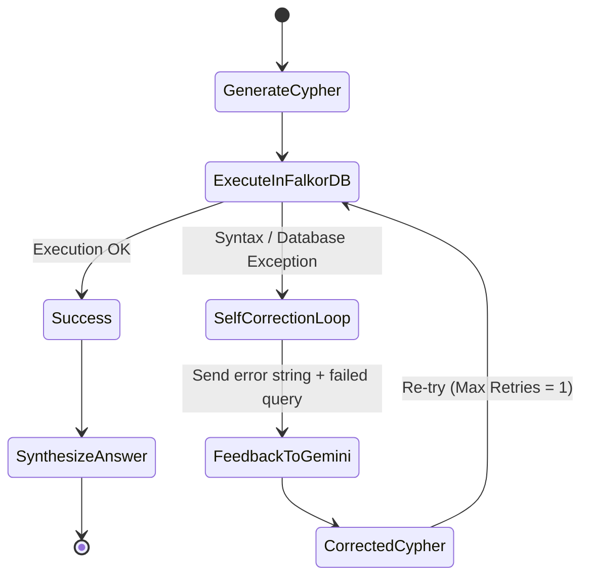

# 🏛️ DevTrace System Architecture Deep-Dive

This document provides a comprehensive technical overview of the **DevTrace** Company Brain architecture, explaining how natural language queries are converted into high-performance graph traversals using **FalkorDB** and **Google Gemini**.

---

## 📐 High-Level Architecture Topology

```
                  ┌─────────────────────────────────────┐
                  │      React + Vite Frontend (UI)      │
                  │   - Glassmorphism Chat Interface    │
                  │   - Live Cypher Transparency Drawer │
                  │   - Quick-Prompt Suggestion Chips   │
                  └──────────────────┬──────────────────┘
                                     │ HTTP POST /api/ask
                                     ▼
                  ┌─────────────────────────────────────┐
                  │       FastAPI Backend Engine        │
                  │   - Pydantic Request / Response     │
                  │   - CORS Middleware & Config        │
                  │   - Offline Demo Mode Fallback      │
                  └──────────┬────────────────┬─────────┘
                             │                │
            1. Text-to-Cypher│                │ 3. Answer Synthesis
                             ▼                ▼
            ┌───────────────────┐          ┌───────────────────┐
            │ Google Gemini AI  │          │ Google Gemini AI  │
            │  (Flash 2.5 LLM)  │          │ (Response Synthesizer)
            └────────┬──────────┘          └───────────────────┘
                     │ Cypher Query                  ▲
                     ▼                               │ Graph Rows
            ┌────────────────────────────────────────┴─────────┐
            │               FalkorDB Graph Engine               │
            │   - In-Memory RedisGraph Engine (Port 6379)      │
            │   - Sparse Matrix Linear Algebra Traversal       │
            │   - Sub-Millisecond Multi-Hop Traversal Latency  │
            └──────────────────────────────────────────────────┘
```

---

## 🔍 The Multi-Hop Reasoning Pipeline

### 1. Natural Language Disambiguation & Cypher Generation
When an engineer asks:
> *"What services break if the Billing DB fails?"*

The request enters `GeminiAgent.generate_cypher()` with a structured schema prompt. The model understands that:
- *"Billing DB"* corresponds to `(:System {name: 'Billing DB'})`
- *"break"* or *"fails"* implies downstream dependencies via incoming `[:DEPENDS_ON]` edges
- Variable-length matching is required to discover direct and transitive dependencies:
```cypher
MATCH (target:System {name: 'Billing DB'})<-[:DEPENDS_ON*1..2]-(dependent:System)
RETURN dependent.name AS affected_service, dependent.tier AS tier, dependent.description AS purpose
```

### 2. Self-Correcting Execution Loop
If an AI model produces invalid Cypher syntax or references non-existent relationship types, the `execute_with_self_correction` handler kicks in:



### 3. FalkorDB: Why Graph Over Vector RAG?

| Capability | Vector RAG / Semantic Search | FalkorDB Knowledge Graph |
|---|---|---|
| **Multi-Hop Traversal** | ❌ Fails (cannot chain hops reliably) | ✅ Native `DEPENDS_ON*1..3` traversals in sub-millisecond |
| **Deterministic Precision** | ❌ Hallucinates approximate text | ✅ Exact ownership and runbook pointers |
| **Transitive Impact Analysis** | ❌ Cannot compute topological paths | ✅ Graph reachability algorithms |
| **Latency** | 200ms - 800ms per retrieval | **< 5ms** using sparse matrix linear algebra |

FalkorDB represents graphs as **sparse adjacency matrices** based on the GraphBLAS standard. Matrix multiplication corresponds directly to edge traversal, delivering unparalleled speed for complex dependency lookups.

---

## 📚 Data Model & Provenance Chains

DevTrace connects 5 primary node categories:
1. **`Person`**: Software engineers, staff architects, SRE leads.
2. **`Team`**: Functional squads (FinTech, Core Infra, Security).
3. **`System`**: Services, databases, event brokers.
4. **`Document`**: Incident runbooks, architecture specs.
5. **`Decision`**: Architecture Decision Records (ADRs).

### Example Provenance Traversal
```cypher
MATCH (p:Person {name: 'Alice Johnson'})-[:RECORDED]->(d:Decision)-[:DOCUMENTS]->(s:System)
RETURN d.title, d.status, d.rationale, s.name;
```
This enables engineers to ask *"Why was the legacy cache migrated?"* and receive the exact ADR, author, approval date, and performance rationale.
